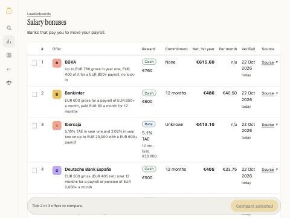

# BankJar

Find the bank offer that pays you most for what you want to do: move your salary, park your savings, open a free account.
Ask in plain words. Get one comparison table where a €800 cash bonus over 12 months and a €1,500 phone over 36 months are on the same scale.

Spain first. Open code (Apache-2.0) and open data (CC BY 4.0). Built for people and for AI agents.

**Live: https://bankjar.fabriquefutur.com** · MCP: `https://bankjar.fabriquefutur.com/mcp`



> Status: alpha, built in the night sprint of 2026-10-21. Offers carry a `verified_on` date; check the source link before you sign anything. Not financial advice.

## Quick start

```bash
git clone https://github.com/zaitsew/bankjar && cd bankjar
cp .env.example .env     # optional: the AI key; the site works without it
./check.sh               # installs nothing; says what is missing, then runs the tests
npm install && npm run dev
open http://localhost:3000
```

## Deploy

```bash
./scripts/deploy.sh          # build here, ship to the droplet, wait for https://bankjar.fabriquefutur.com/api/v1/goals
./scripts/deploy.sh --dry    # print the steps, touch nothing
```

The droplet has 1 GB of RAM and cannot compile Next, so the script builds on your machine and ships the standalone output; the image is built on the box. Needs ssh access as `deploy@159.89.99.84`. The first run creates `/srv/bankjar/` with the platform's `add-product.sh`. Files: `deploy/droplet/`.

## What it does / doesn't

- Does: rank Spanish bank offers by goal with one transparent formula; show every catch and the source; answer agents over JSON and MCP.
- Also: rank Spanish bank mobile apps (0 to 100 from store ratings, release freshness, reach and Bizum / Apple Pay / Google Pay / English) on `/apps`, at `/api/v1/apps` and with the MCP tool `rank_bank_apps`. One YAML per app in `data/apps/es/`; `npm run fetch-apps` refreshes the store numbers.
- Doesn't: take paid placement, give personal financial advice, or invent numbers — the AI only parses your question and summarises rows from `data/`.

## For agents

See `docs/ARCHITECTURE.md` → "For agents": `/api/v1/search`, `/api/v1/offers`, `/api/v1/apps`, `/openapi.json`, `/llms.txt`, `/data/offers.json`, and the MCP endpoint `/mcp`.

## Contributing an offer

One offer is one YAML file in `data/offers/es/`. Copy a neighbour, change the terms, put the bank's page in `source_url`, and open a pull request. `./check.sh` validates the file.

## Contributing an app feature

Store numbers are written by `npm run fetch-apps`. Bizum, Apple Pay and Google Pay are filled in by hand in `data/apps/es/<bank>.yaml`: set `value` to `true` or `false` and put the page that shows it in `source_url`. A known value without a source fails `./check.sh`.

## Docs

`docs/BRIEF.md` (the owner's words) · `docs/PLAN.md` · `docs/ARCHITECTURE.md` · `docs/ROADMAP.md` · `docs/NIGHT-SPRINT.md` · `docs/VERIFICATION.md`

## Licence

Code: Apache-2.0 (`LICENSE`). Data in `data/`: CC BY 4.0 (`data/LICENSE`).
