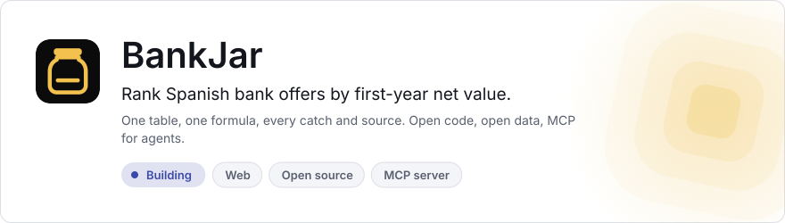
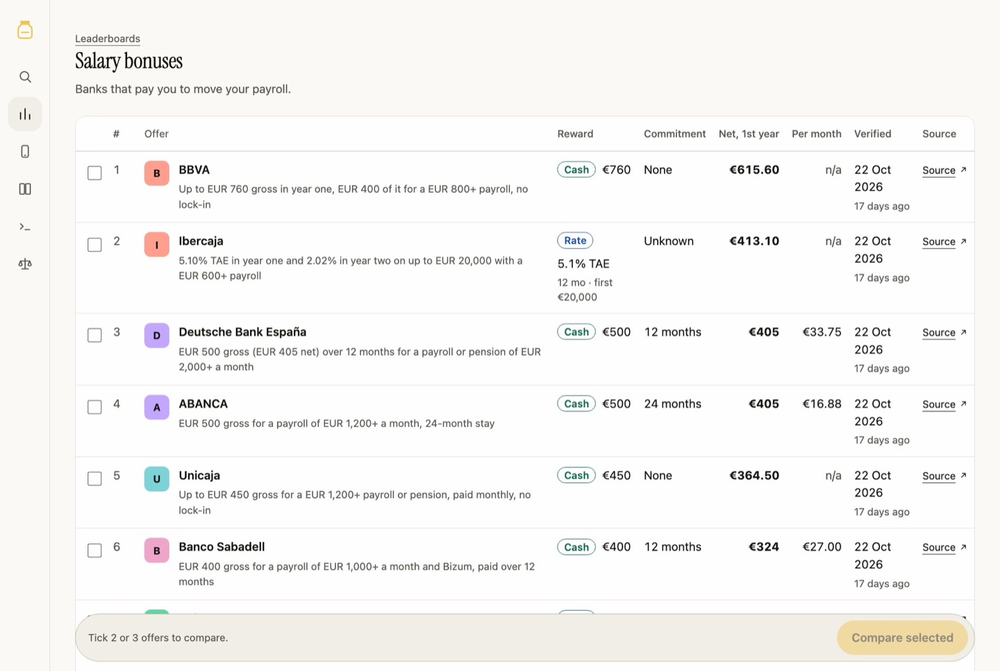
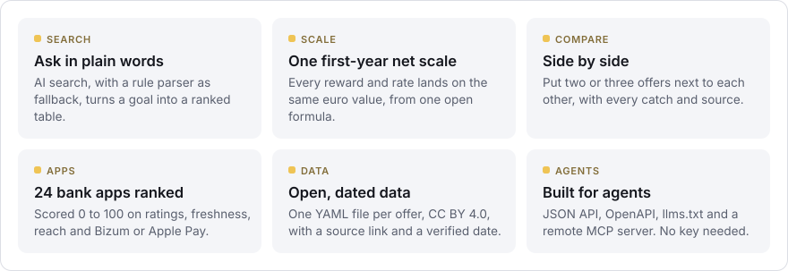
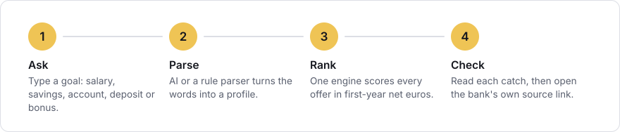
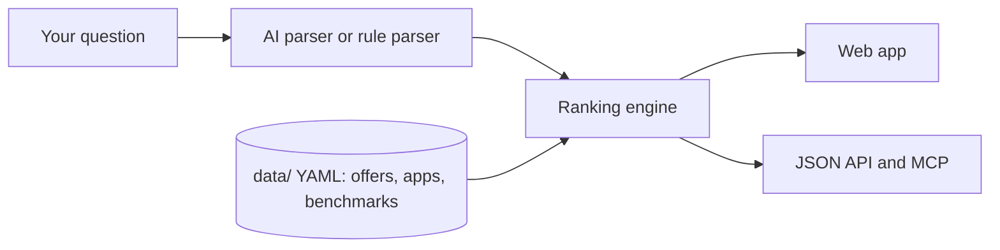

<!-- Pictures: docs/readme/spec.json, drawn by readme-kit. Do not edit the SVGs by hand. -->
<picture><source media="(prefers-color-scheme: dark)" srcset="docs/readme/hero-dark.svg"></picture>

**Say what you want from your bank, and see which Spanish offer pays most after its catches.**

BankJar covers salary bonuses, savings, free accounts, term deposits and welcome bonuses: 66 offers, each with its catch and its source. It also ranks 24 Spanish bank apps. Open code (Apache-2.0), open data (CC BY 4.0), for people and for AI agents. Alpha, live on the web.

**[Live site](https://bankjar.fabriquefutur.com)** · **[MCP server](https://bankjar.fabriquefutur.com/mcp)** · [Claude directory](https://claude.ai/directory/connectors/bankjar) · [Docs](#docs)

<p align="center"></p>

> **Check before you sign.** Offers carry a `verified_on` date and leave the ranking 60 days after it (or at `valid_until`). Check the source link first. Not financial advice.

## What it does

<picture><source media="(prefers-color-scheme: dark)" srcset="docs/readme/highlights-dark.svg"></picture>

<details>
<summary>App scoring and market benchmarks: inputs, endpoints, refresh commands</summary>

- **Bank apps.** Spanish bank mobile apps score 0 to 100 from store ratings, release freshness, reach and Bizum / Apple Pay / Google Pay / English. They are on `/apps`, at `/api/v1/apps` and in the MCP tool `rank_bank_apps`. One YAML per app in `data/apps/es/`; `npm run fetch-apps` refreshes the store numbers.
- **Market context.** The savings and deposit leaderboards show a strip of official reference numbers: Banco de España average rate on new household deposits up to 1 year, ECB deposit facility rate, 12-month Letra yield, CPI year on year. Each has its period, source link and fetched date, and a Stale badge when old. Savings and deposit offer pages show the offer's TAE minus the BdE average, in percentage points.
- **Where the benchmarks live.** `/api/v1/benchmarks`, the MCP tool `get_benchmarks`, `llms-full.txt` and `/data/offers.json`. One YAML per series in `data/benchmarks/es/`; `npm run fetch-benchmarks` refreshes them from the publishers' APIs.
- **Benchmarks never rank.** They are context: they never change a score or an order.

</details>

**What it does not do.** BankJar takes no paid placement, gives no personal financial advice and invents no numbers. The AI only parses your question and summarises rows from `data/`.

## How it works

<picture><source media="(prefers-color-scheme: dark)" srcset="docs/readme/steps-dark.svg"></picture>



## Quick start

```bash
git clone https://github.com/zaitsew/bankjar && cd bankjar
cp .env.example .env     # optional: the AI key; the site works without it
./check.sh               # installs nothing; says what is missing, then runs the tests
npm install && npm run dev
open http://localhost:3000
```

`./check.sh` is the first-run check: it names what is missing, then runs the tests.

<details>
<summary>Deploy</summary>

```bash
./scripts/deploy.sh          # build here, ship to the droplet, wait for https://bankjar.fabriquefutur.com/api/v1/goals
./scripts/deploy.sh --dry    # print the steps, touch nothing
```

The droplet has 1 GB of RAM and cannot compile Next, so the script builds on your machine and ships the standalone output; the image is built on the box. Needs ssh access as `deploy@159.89.99.84`. The first run creates `/srv/bankjar/` with the platform's `add-product.sh`. Files: `deploy/droplet/`.

</details>

## For Claude

```sh
/plugin install bankjar --marketplace zaitsew/bankjar
```

The plugin in `plugin/` adds the `bank-offers` skill and connects the public MCP server. No account or key. Details: [plugin/README.md](plugin/README.md).
The BankJar connector is also in the [Claude directory](https://claude.ai/directory/connectors/bankjar). The page `/connect` shows how to add it to Claude, ChatGPT or Codex.

## For agents

| Entry point | Path |
|---|---|
| Search, offers, compare, goals, apps | `/api/v1/search`, `/api/v1/offers`, `/api/v1/compare`, `/api/v1/goals`, `/api/v1/apps` |
| Schema and hints | `/openapi.json`, `/llms.txt` |
| Whole dataset | `/data/offers.json` |
| MCP endpoint | `/mcp` |

More in `docs/ARCHITECTURE.md` under "For agents".

## Contribute

<details>
<summary>Report a wrong offer</summary>

Every offer page links to a "Report a wrong offer" form with the offer id filled in. It asks for the source link and the date you saw. Issues are public. [Open the form](https://github.com/zaitsew/bankjar/issues/new?template=wrong-offer.yml).

</details>

<details>
<summary>Contributing an offer</summary>

One offer is one YAML file in `data/offers/es/`. Copy a neighbour, change the terms, put the bank's page in `source_url`, and open a pull request. `./check.sh` validates the file. A new bank also needs `data/issuers/es/<bank_slug>.yaml` (deposit-guarantee scheme, legal entity, source); `./check.sh` fails without it.

Check offers against their sources with `npm run verify-offers` (one bank: `npm run verify-offers -- bbva`). It fetches each `source_url`, looks for the numbers the YAML states and writes a report to `runs/verify-offers/`. It is read-only: it never edits `data/` or `verified_on`, and a page it cannot fetch counts as not verified.

</details>

<details>
<summary>Contributing an app feature</summary>

Store numbers are written by `npm run fetch-apps`. Bizum, Apple Pay and Google Pay are filled in by hand in `data/apps/es/<bank>.yaml`: set `value` to `true` or `false` and put the page that shows it in `source_url`. A known value without a source fails `./check.sh`.

The store numbers refresh every Monday: `scripts/refresh-apps.sh` fetches them, opens and merges a data-only PR after `./check.sh`, and deploys. `scripts/install-launchd.sh` installs the job (`--remove` uninstalls it); `scripts/refresh-apps.sh --dry` shows the diff without shipping. Log: `~/Library/Logs/bankjar-app-refresh.log`.

</details>

## Legal pages

The site has [privacy](https://bankjar.fabriquefutur.com/privacy), [terms](https://bankjar.fabriquefutur.com/terms), [support](https://bankjar.fabriquefutur.com/support) and [data deletion](https://bankjar.fabriquefutur.com/data-deletion) pages. BankJar has no accounts and stores no profile.

## Docs

| Document | What is in it |
|---|---|
| [docs/BRIEF.md](docs/BRIEF.md) | The owner's kickoff, verbatim |
| [docs/PLAN.md](docs/PLAN.md) | The question BankJar answers, and the plan |
| [docs/ARCHITECTURE.md](docs/ARCHITECTURE.md) | How it is built, and the "For agents" section |
| [docs/ROADMAP.md](docs/ROADMAP.md) | Done and next, with the reasons in `docs/DECISIONS.md` |
| [docs/NIGHT-SPRINT.md](docs/NIGHT-SPRINT.md) | The first night sprint, 2026-10-21 to 2026-10-22 |
| [docs/VERIFICATION.md](docs/VERIFICATION.md) | Night-sprint verification record |

## Licence

Code: Apache-2.0 ([LICENSE](LICENSE)). Data in `data/`: CC BY 4.0 ([data/LICENSE](data/LICENSE)).

<sub>Built by <a href="https://github.com/zaitsew">zaitsew</a> with a fleet of AI agents.</sub>

<!-- teyla:reviewed 2026-11-13 -->
