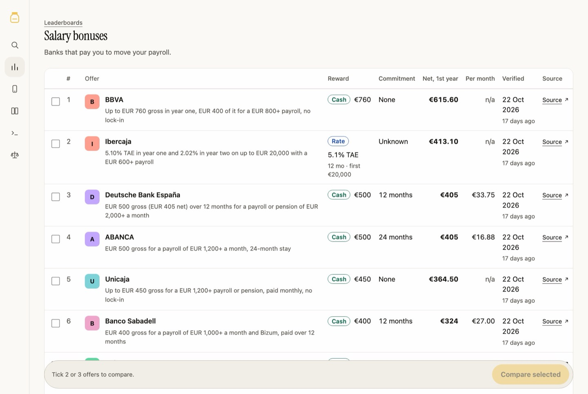

# BankJar

BankJar ranks 69 Spanish bank offers by what you want to do: move your salary, park savings, open a free account, take a deposit or a welcome bonus.
Ask in plain words (AI search, with a rule parser as fallback) and get one table that puts every reward on the same first-year net scale.
It also ranks 24 Spanish bank apps. Open code (Apache-2.0), open data (CC BY 4.0), for people and for AI agents.

**Live: https://bankjar.fabriquefutur.com** · MCP: `https://bankjar.fabriquefutur.com/mcp`



> Status: alpha, live on the web. Offers carry a `verified_on` date and leave the ranking 60 days after it (or at `valid_until`). Check the source link before you sign anything. Not financial advice.

## Quick start

```bash
git clone https://github.com/zaitsew/bankjar && cd bankjar
cp .env.example .env     # optional: the AI key; the site works without it
./check.sh               # installs nothing; says what is missing, then runs the tests
npm install && npm run dev
open http://localhost:3000
```

## Deploy

```bash
./scripts/deploy.sh          # build here, ship to the droplet, wait for https://bankjar.fabriquefutur.com/api/v1/goals
./scripts/deploy.sh --dry    # print the steps, touch nothing
```

The droplet has 1 GB of RAM and cannot compile Next, so the script builds on your machine and ships the standalone output; the image is built on the box. Needs ssh access as `deploy@159.89.99.84`. The first run creates `/srv/bankjar/` with the platform's `add-product.sh`. Files: `deploy/droplet/`.

## What it does / doesn't

- Does: rank Spanish bank offers by goal (salary, savings, account, deposit, welcome) with one transparent formula (`/methodology`); show every catch and the source; compare two to three offers side by side; answer agents over JSON and MCP.
- Also: rank Spanish bank mobile apps (0 to 100 from store ratings, release freshness, reach and Bizum / Apple Pay / Google Pay / English) on `/apps`, at `/api/v1/apps` and with the MCP tool `rank_bank_apps`. One YAML per app in `data/apps/es/`; `npm run fetch-apps` refreshes the store numbers.
- Doesn't: take paid placement, give personal financial advice, or invent numbers — the AI only parses your question and summarises rows from `data/`.

## For Claude

```sh
/plugin install bankjar --marketplace zaitsew/bankjar
```

The plugin in `plugin/` adds the `bank-offers` skill and connects the public MCP server. No account or key. Details: [plugin/README.md](plugin/README.md).
The BankJar connector is also in the [Claude directory](https://claude.ai/directory/connectors/bankjar). The page `/connect` shows how to add it to Claude, ChatGPT or Codex.

## For agents

See `docs/ARCHITECTURE.md` → "For agents": `/api/v1/search`, `/api/v1/offers`, `/api/v1/compare`, `/api/v1/goals`, `/api/v1/apps`, `/openapi.json`, `/llms.txt`, `/data/offers.json`, and the MCP endpoint `/mcp`.

## Report a wrong offer

Every offer page links to a "Report a wrong offer" form with the offer id filled in. It asks for the source link and the date you saw. Issues are public. [Open the form](https://github.com/zaitsew/bankjar/issues/new?template=wrong-offer.yml).

## Contributing an offer

One offer is one YAML file in `data/offers/es/`. Copy a neighbour, change the terms, put the bank's page in `source_url`, and open a pull request. `./check.sh` validates the file.

Check offers against their sources with `npm run verify-offers` (one bank: `npm run verify-offers -- bbva`). It fetches each `source_url`, looks for the numbers the YAML states and writes a report to `runs/verify-offers/`. It is read-only: it never edits `data/` or `verified_on`, and a page it cannot fetch counts as not verified.

## Contributing an app feature

Store numbers are written by `npm run fetch-apps`. Bizum, Apple Pay and Google Pay are filled in by hand in `data/apps/es/<bank>.yaml`: set `value` to `true` or `false` and put the page that shows it in `source_url`. A known value without a source fails `./check.sh`.

The store numbers refresh every Monday: `scripts/refresh-apps.sh` fetches them, opens and merges a data-only PR after `./check.sh`, and deploys. `scripts/install-launchd.sh` installs the job (`--remove` uninstalls it); `scripts/refresh-apps.sh --dry` shows the diff without shipping. Log: `~/Library/Logs/bankjar-app-refresh.log`.

## Legal pages

The site has [privacy](https://bankjar.fabriquefutur.com/privacy), [terms](https://bankjar.fabriquefutur.com/terms), [support](https://bankjar.fabriquefutur.com/support) and [data deletion](https://bankjar.fabriquefutur.com/data-deletion) pages. BankJar has no accounts and stores no profile.

## Docs

`docs/BRIEF.md` (the owner's words) · `docs/PLAN.md` · `docs/ARCHITECTURE.md` · `docs/ROADMAP.md` · `docs/NIGHT-SPRINT.md` · `docs/VERIFICATION.md`

## Licence

Code: Apache-2.0 (`LICENSE`). Data in `data/`: CC BY 4.0 (`data/LICENSE`).

<!-- teyla:reviewed 2026-11-13 -->
